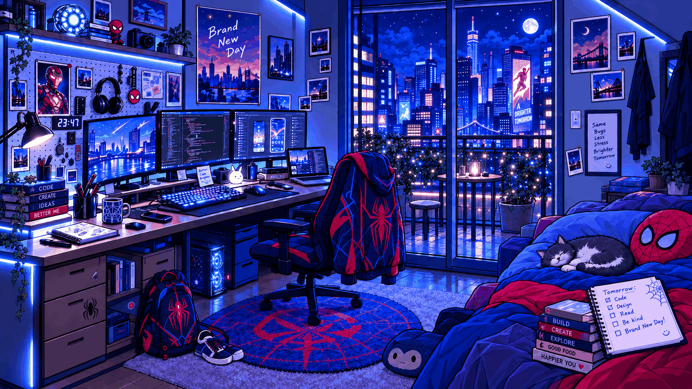

<!--
  TDatCr7 | GitHub Profile README
  Theme: Ocean Tech (Navy #0B2545 / Cyan #38BDF8)
  Edit only the links/content you want to share publicly.
  Existing image: assets/profile.gif (keep your current file).
  New animation: assets/trying-blue-flame.gif.
-->

<!-- OPTIONAL BANNER: upload your own file to assets/banner.gif (or .png),
     update its filename below, then remove this comment block.

  

-->

  

<h1 align="center">Hey there! I'm Ngo Nguyen Tien Dat 👋</h1>

  <strong>Software Engineering Student · Aspiring Full-stack Developer</strong>

  

<!-- Animated tagline: this GIF replaces the plain-text 'Trying to do better.' line. -->

  

  

---

## 👨‍💻 About Me

- 🎓 Software Engineering student at **HUTECH University**, class of **2026**.
- 💻 I enjoy building **web and mobile applications**, from user interfaces to backend APIs and databases.
- 🎯 My goal is to grow into a **Full-stack Developer** and contribute to real-world products.
- 🤝 I value teamwork, curiosity, and continuous improvement.

## 🧰 Tech Stack

**Languages & Web**

  

**Frameworks & Libraries**

  

Also worked with ASP.NET Core MVC and Entity Framework Core.

**Databases**

  

**Tools**

  

## 🎮 Beyond Coding

💻 Exploring technology & developer tools · 🎮 PUBG & Liên Quân (Arena of Valor) · 🎬 Movies

## 📊 GitHub Activity

  
  

<!-- Third-party statistics may be temporarily unavailable. -->

## 🌐 Connect With Me

  
  
  
  

  <!-- INSTAGRAM: Replace YOUR_USERNAME with your link, then remove the two comment boundary lines.
  
  -->

  <!-- DISCORD: Replace YOUR_USER_ID with your link, then remove the two comment boundary lines.
  
  -->

---

## 💭 Quote I Live By

  

